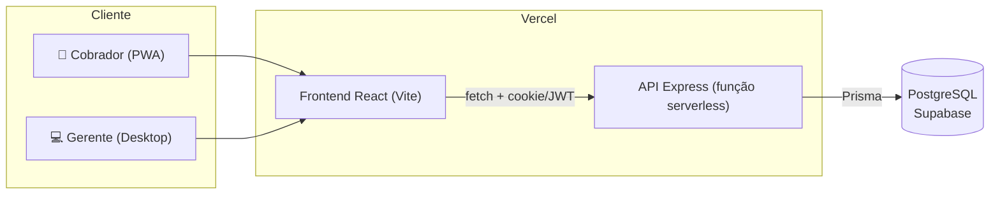
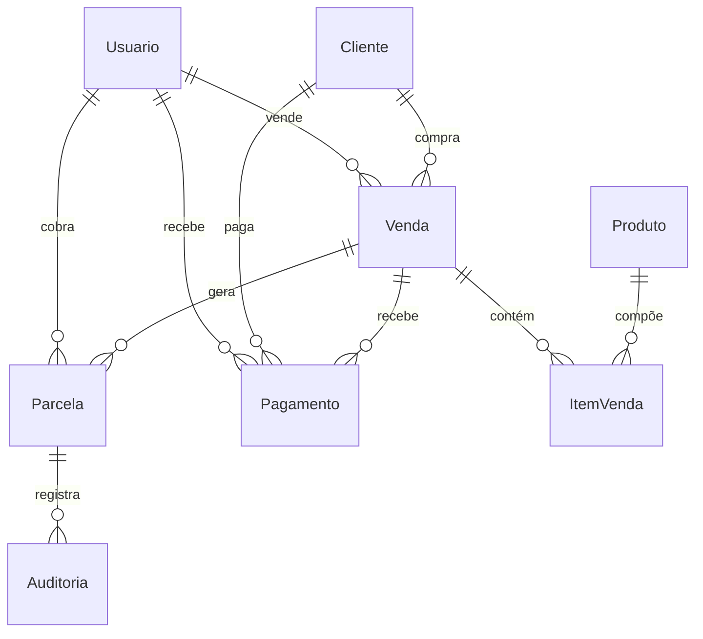

<div align="center">

# 💳 Crediário System

**Gestão de crediário próprio e cobrança de rua, do carnê ao fechamento do dia.**

[](https://crediario-systen-mu.vercel.app)


</div>

---

## 📑 Sumário

- [Sobre o projeto](#-sobre-o-projeto)
- [Funcionalidades](#-funcionalidades)
- [Regras de negócio](#-regras-de-negócio)
- [Stack](#-stack)
- [Arquitetura](#-arquitetura)
- [Estrutura do repositório](#-estrutura-do-repositório)
- [Rodando localmente](#-rodando-localmente)
- [Variáveis de ambiente](#-variáveis-de-ambiente)
- [API REST](#-api-rest)
- [Modelo de dados](#-modelo-de-dados)
- [Segurança](#-segurança)
- [Deploy](#-deploy)
- [Backup e scripts de manutenção](#-backup-e-scripts-de-manutenção)
- [Fluxo de trabalho (Git)](#-fluxo-de-trabalho-git)
- [Próximos passos](#-próximos-passos)

---

## 📱 Sobre o projeto

O **Crediário System** digitaliza a operação de lojas que vendem a prazo no carnê (crediário próprio) e usam cobradores de rua. Ele substitui cadernetas e planilhas por um sistema único, em produção, com dois ambientes sob medida:

| Perfil | Interface | O que faz |
| :--- | :--- | :--- |
| **Gerente** (`GERENTE`) | Painel **desktop** | Acompanha a carteira, gerencia funcionários, clientes, produtos e vendas, e confere os relatórios. |
| **Vendedor / Cobrador** (`VENDEDOR_COBRADOR`) | App **mobile** (PWA instalável) | Registra vendas, cobra parcelas na rua, atende clientes e fecha o resumo do dia. |

A interface é escolhida automaticamente pelo perfil do usuário logado, dentro da mesma aplicação React.

---

## ✨ Funcionalidades

### 🛵 App do Vendedor / Cobrador (mobile)

| Aba | Descrição |
| :--- | :--- |
| **Resumo** | Prestação de contas do dia: vendido, cobrado e detalhes de cada operação. |
| **Cobranças** | Parcelas pendentes e atrasadas para cobrar, com baixa de pagamento e contato com o cliente. |
| **Nova Venda** | Venda com um ou mais produtos, entrada opcional e parcelamento mensal, quinzenal ou semanal. |
| **Clientes** | Cadastro e edição, saldo devedor, parcelas do cliente, pagamento antecipado e alteração da data de vencimento. |
| **Hist. Cobr.** | Extrato de cobranças de dias anteriores. |
| **Hist. Vendas** | Extrato de vendas de dias anteriores. |

### 🖥️ Painel do Gerente (desktop)

| Aba | Descrição |
| :--- | :--- |
| **Dashboard Inicial** | Visão geral da operação. |
| **Funcionários** | Criação e listagem de usuários, e prestação de contas por funcionário. |
| **Clientes** | Consulta e edição de clientes e saldo devedor. |
| **Vendas** | Listagem e detalhes de vendas. |
| **Cobranças** | Parcelas em aberto e ajuste manual de valor. |
| **Relatório Mensal** | Consolidado por funcionário: vendido, cobrado e parcelas em atraso. |
| **Produtos** | Catálogo (móveis e variedades). |

### 📲 PWA
O app tem `manifest.json` e Service Worker. Pode ser instalado na tela inicial do celular e exibe um banner de instalação.

---

## 📐 Regras de negócio

### Venda e carnê
- A venda aceita **vários itens**, com cálculo automático de subtotal e total.
- **Entrada** opcional (deve ser menor que o total). Só o valor financiado é parcelado.
- **Periodicidade:** `MENSAL`, `QUINZENAL` (2 parcelas por mês) ou `SEMANAL` (4 por mês). O número de parcelas é multiplicado conforme a periodicidade.
- O valor é dividido com arredondamento para baixo, e **o resto em centavos vai para a última parcela**, para o total bater exatamente.
- Venda, itens e parcelas são criados em uma **única transação** (`prisma.$transaction`): ou grava tudo, ou nada.

### Parcelas
```
PENDENTE ──(pagamento parcial)──► PARCIAL ──(quita)──► PAGA
    │                                 │
    └──────(vencimento passou)────────┴──► ATRASADA ──(pagamento)──► PARCIAL / PAGA
```
- Parcelas vencidas são marcadas como `ATRASADA` automaticamente ao listar parcelas e gerar relatórios.
- **Pagamento parcial** mantém a parcela como `PARCIAL` com o saldo restante.
- **Excedente:** se o cliente paga mais que a parcela, o valor extra é abatido nas **próximas parcelas em aberto**, na ordem.
- **Alterar vencimento:** recalcula o status (uma parcela atrasada volta a `PENDENTE` se a nova data for futura). Não é permitido em parcela já paga.
- **Ajuste manual de valor:** só o Gerente.
- Operações sensíveis em parcelas gravam um registro na tabela de **auditoria**.

### Permissões

| Ação | Gerente | Cobrador |
| :--- | :---: | :---: |
| Login, clientes, vendas, baixa de parcelas, alterar vencimento, produtos | ✅ | ✅ |
| Prestação de contas do próprio dia | ✅ | ✅ |
| Ajuste manual de parcela | ✅ | ❌ |
| Listar e criar usuários | ✅ | ❌ |
| Relatório mensal | ✅ | ❌ |
| Prestação de contas de outros funcionários | ✅ | ❌ |

---

## 🧰 Stack

| Camada | Tecnologias |
| :--- | :--- |
| **Frontend** | React 19, TypeScript, Vite 8, lucide-react, CSS próprio, PWA (Service Worker) |
| **Backend** | Node.js, Express 5, TypeScript |
| **Banco** | PostgreSQL (Supabase) via Prisma ORM 6 |
| **Segurança** | JWT (cookie httpOnly), bcryptjs, Zod 4, Helmet, CORS, express-rate-limit |
| **Infra** | Vercel (frontend + função serverless da API), Docker / Docker Compose + Nginx (alternativa) |
| **Qualidade** | TypeScript `strict`, oxlint (frontend) |

---

## 🏗️ Arquitetura



O backend é dividido em `app.ts` (configura o Express) e `server.ts` (sobe o servidor HTTP). Isso permite rodar o mesmo código como função serverless na Vercel (`api/index.ts`) ou como container Docker.

Fluxo de uma requisição: `rota → authMiddleware → roleMiddleware (se exigido) → validateBody (Zod) → controller → Prisma → resposta`.

---

## 🗂️ Estrutura do repositório

```
CrediarioSysten/
├── api/
│   └── index.ts                # Entrada serverless da Vercel (reexporta o app Express)
├── backend/
│   ├── prisma/                 # schema.prisma e migrations
│   └── src/
│       ├── app.ts / server.ts  # Express (app) e servidor HTTP
│       ├── controllers/        # auth, cliente, venda, parcela, pagamento, produto,
│       │                       # user, relatorio e prestacaoContas
│       ├── routes/             # Mapeamento dos endpoints
│       ├── middlewares/        # auth, role, validate (Zod) e rateLimiter
│       ├── validators/         # Schemas Zod
│       ├── config/ lib/        # JWT e cliente Prisma
│       └── scripts/            # Seeds, migrações pontuais e utilitários
├── frontend/
│   ├── public/                 # manifest.json, sw.js e ícones (PWA)
│   └── src/
│       ├── components/         # auth, desktop, mobile, layout e common
│       ├── context/ hooks/     # AuthContext e useAuth
│       └── services/api.ts     # Todas as chamadas à API
├── scripts/                    # fazer-backup.ps1 e restaurar-backup.ps1
├── docker-compose.yml
├── vercel.json                 # Rewrites das rotas da API
└── package.json                # Scripts da raiz
```

---

## 🛠️ Rodando localmente

**Pré-requisitos:** Node.js 20+, npm e um banco PostgreSQL (pode ser um projeto Supabase gratuito).

```bash
# 1. Clonar e entrar na branch de desenvolvimento
git clone https://github.com/vitoraugustonb-cod/CrediarioSysten.git
cd CrediarioSysten
git checkout develop

# 2. Dependências
npm --prefix backend install
npm --prefix frontend install

# 3. Variáveis de ambiente do backend
cp backend/.env.example backend/.env      # Windows: copy backend\.env.example backend\.env
# edite backend/.env com DATABASE_URL, DIRECT_URL e JWT_SECRET

# 4. Banco: gerar cliente Prisma e aplicar o schema
npm run prisma:generate
npm run prisma:migrate                    # dev  (ou: npm run prisma:push)

# 5. Criar o primeiro usuário Gerente (a senha vem de uma variável, nunca do código)
# Windows (PowerShell):  $env:SENHA_INICIAL='sua-senha-forte'; npm run seed
# Linux / macOS:         SENHA_INICIAL='sua-senha-forte' npm run seed
npm run seed

# 6. Subir os dois lados (em terminais separados)
npm run dev:backend      # API em http://localhost:3300
npm run dev:frontend     # App em http://localhost:5173
```

O Vite já faz **proxy** das rotas da API para `localhost:3300`, então o frontend não precisa de `VITE_API_URL` no desenvolvimento.

> 🔑 Nenhuma senha fica escrita no código. Para **trocar a senha de um usuário existente** (altera só essa linha, sem apagar nada):
>
> ```powershell
> $env:EMAIL_USUARIO='usuario@exemplo.com'; $env:NOVA_SENHA='nova-senha-forte'; npm --prefix backend run trocar-senha
> ```

### Docker (alternativa)

```bash
docker compose up --build
```
Backend em `http://localhost:3300` e frontend (Nginx) em `http://localhost`. O backend lê `backend/.env`.

---

## ⚙️ Variáveis de ambiente

### Backend (`backend/.env`)

| Variável | Obrigatória | Descrição |
| :--- | :---: | :--- |
| `DATABASE_URL` | ✅ | Conexão do banco. No Supabase, use o **Transaction Pooler** (porta 6543, `?pgbouncer=true`). |
| `DIRECT_URL` | ✅ | Conexão direta (porta 5432), usada pelo Prisma nas migrações. |
| `JWT_SECRET` | ✅ em produção | Chave de assinatura dos tokens. Em produção, o servidor **não inicia** sem ela. |
| `PORT` | ❌ | Porta local (padrão do projeto: `3300`). |
| `JWT_EXPIRES_IN` | ❌ | Validade do token (padrão `7d`). É renovado automaticamente após metade da validade enquanto o usuário usa o app. |
| `FRONTEND_URL` | ❌ | Origem extra liberada no CORS. Domínios `*.vercel.app` e `localhost` já são aceitos. |

### Frontend

| Variável | Descrição |
| :--- | :--- |
| `VITE_API_URL` | URL base da API. Se vazia, usa o mesmo domínio (caso da Vercel) ou o proxy do Vite. |

Nunca versione arquivos `.env` (já estão no `.gitignore`).

---

## 🌐 API REST

Todas as rotas, exceto `/login`, `/logout` e `/health`, exigem autenticação (cookie httpOnly ou header `Authorization: Bearer <token>`).

| Método | Rota | Acesso | Descrição |
| :--- | :--- | :---: | :--- |
| `POST` | `/login` | público | Login (limite de 5 tentativas / 15 min por IP). |
| `POST` | `/logout` | público | Encerra a sessão e limpa o cookie. |
| `GET` | `/health` | público | Verificação de saúde. |
| `GET` `POST` | `/clientes` | logado | Listar e cadastrar clientes. |
| `GET` `PATCH` | `/clientes/:id` | logado | Detalhe e atualização. |
| `GET` | `/clientes/:id/saldo` | logado | Saldo devedor e parcelas do cliente. |
| `GET` `POST` | `/produtos` | logado | Listar e cadastrar produtos. |
| `POST` `GET` | `/vendas` | logado | Registrar venda (gera o carnê) e listar. |
| `GET` | `/vendas/:id` | logado | Detalhe da venda. |
| `GET` | `/vendas/dias-fechados` | logado | Dias anteriores com vendas. |
| `GET` | `/vendas/extrato-dia?data=` | logado | Extrato de vendas de um dia. |
| `GET` | `/parcelas` | logado | Parcelas em aberto (atualiza as atrasadas). |
| `GET` | `/parcelas/historico` | logado | Parcelas pagas. |
| `PATCH` | `/parcelas/:id/pagamento` | logado | Baixa de pagamento (total, parcial ou com excedente). |
| `PATCH` | `/parcelas/:id/data-vencimento` | logado | Altera o vencimento. Aceita `dataVencimento` ou `novaDataVencimento` (`YYYY-MM-DD`). |
| `PATCH` | `/parcelas/:id/observacao` | logado | Registra observação. |
| `PATCH` | `/parcelas/:id/contato` | logado | Registra data/hora do contato com o cliente. |
| `PATCH` | `/parcelas/:id/ajuste` | **Gerente** | Ajuste manual de valor (com motivo). |
| `GET` | `/pagamentos/dias-fechados` | logado | Dias anteriores com cobranças. |
| `GET` | `/pagamentos/extrato-dia?data=` | logado | Extrato de cobranças de um dia. |
| `GET` | `/prestacao-contas/dia` | logado | Resumo do próprio dia. |
| `GET` | `/prestacao-contas/dia/:usuarioId` | logado | Resumo do dia de um funcionário. |
| `GET` `POST` | `/usuarios` | **Gerente** | Listar e criar usuários. |
| `GET` | `/relatorios/mensal` | **Gerente** | Consolidado mensal por funcionário. |

Erros de validação retornam `400` com `{ "erro": "...", "detalhes": [{ "campo", "mensagem" }] }`. Os demais erros seguem o formato `{ "erro": "mensagem" }`.

---

## 🗃️ Modelo de dados



| Modelo | Papel |
| :--- | :--- |
| `Usuario` | Funcionário com perfil `GERENTE` ou `VENDEDOR_COBRADOR`, hash de senha e flag `ativo`. |
| `Cliente` | Nome, telefone, endereço e referências. |
| `Produto` | Nome, descrição, preço e categoria (`MOVEIS` / `VARIEDADES`). |
| `Venda` | Cliente, vendedor, total, entrada, número de parcelas e tipo (`MOVEIS` / `VARIEDADES`). |
| `ItemVenda` | Produto, quantidade, valor unitário e subtotal. |
| `Parcela` | Número, valor, valor pago, vencimento, pagamento, status, observação e último contato. |
| `Pagamento` | Histórico de cada valor recebido (base dos extratos e da prestação de contas). |
| `Auditoria` | Registro de ações sobre parcelas (usuário, ação, detalhes e data). |

Valores monetários usam `Decimal(10,2)`. A definição completa está em [`backend/prisma/schema.prisma`](backend/prisma/schema.prisma).

---

## 🔒 Segurança

- **Autenticação:** JWT válido por 24h, enviado em **cookie `httpOnly`** (`Secure` e `SameSite=None` em produção) e também aceito via header `Bearer`.
- **Senhas:** armazenadas com hash `bcrypt`.
- **Autorização:** `roleMiddleware` restringe rotas administrativas ao Gerente.
- **Validação de entrada:** schemas **Zod** com whitelist nos corpos de requisição.
- **Rate limit:** login com 5 tentativas / 15 min por IP, e API geral com 120 requisições / min.
- **Headers e CORS:** Helmet e CORS com credenciais, restrito a origens conhecidas e `*.vercel.app`.
- **Corpo da requisição** limitado a 1 MB.
- **Erros em produção:** mensagens genéricas, sem stack trace.
- **Transações atômicas** nas operações financeiras críticas.

---

## ☁️ Deploy

Produção na **Vercel** (frontend + API serverless) com banco no **Supabase**.

- `vercel.json` define o diretório de saída (`frontend/dist`) e os *rewrites* que enviam as rotas da API para `api/index.ts`. **Ao criar uma rota nova na API, adicione o prefixo dela ao padrão de rewrite.**
- O build roda `npm run vercel-build`: instala dependências, gera o Prisma Client e compila o frontend.
- Configure `DATABASE_URL`, `DIRECT_URL`, `JWT_SECRET` e `NODE_ENV=production` nas variáveis de ambiente da Vercel.
- O deploy automático é disparado por push na branch **`main`**.

---

## 💾 Backup e scripts de manutenção

```bash
npm --prefix backend run backup      # gera um dump em backups/ (PowerShell)
```
- `scripts/fazer-backup.ps1` e `scripts/restaurar-backup.ps1` fazem backup e restauração do banco. A pasta `backups/` não é versionada.
- `backend/src/scripts/` reúne seeds, migrações pontuais (`backfillPagamentos`, `migrateMultiplosProdutos`) e scripts de teste manual.

> 🛑 **Atenção:** `resetBanco.ts` e `limparBanco.ts` **apagam dados**. Nunca os execute contra o banco de produção.

---

## 🌿 Fluxo de trabalho (Git)

- `develop`: desenvolvimento diário. Todo commit entra aqui.
- `main`: produção. Recebe apenas merges de `develop` depois de testado e validado.
- Mensagens de commit seguem [Conventional Commits](https://www.conventionalcommits.org/) (`feat:`, `fix:`, `docs:`, `chore:`).
- Mudanças de schema devem ser **retrocompatíveis**, sem perda de dados.

---

## 🗺️ Próximos passos

Ideias planejadas, ainda **não implementadas**:

- [ ] Testes automatizados (API e fluxos principais)
- [ ] Notificações push para parcelas vencendo no dia
- [ ] Exportação de relatórios (PDF / Excel)
- [ ] Modo offline para cobranças em campo
- [ ] Renegociação de dívidas
- [ ] Cobrança via Pix

---

<div align="center">

Desenvolvido por **Vitor Augusto** · [GitHub](https://github.com/vitoraugustonb-cod)

</div>
